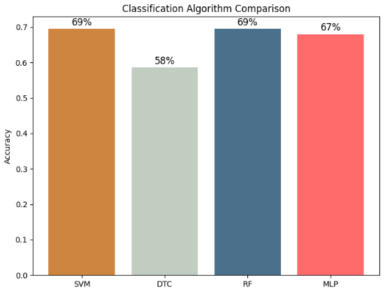
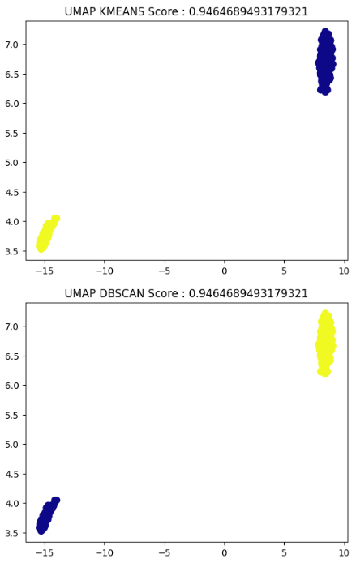
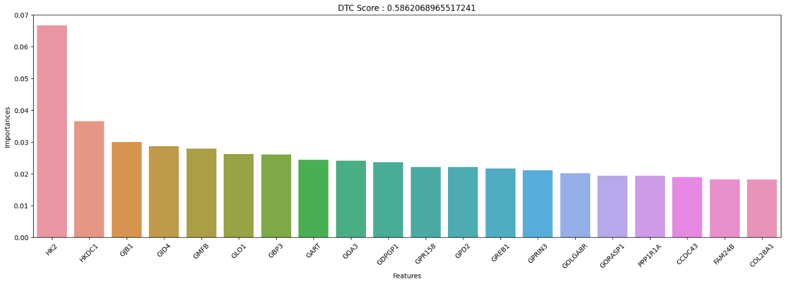

# Alzheimer's Prediction from Genetic Sequence Data

Coursework project, 2023.

## Problem

Predict Alzheimer's disease from the `alzheimer_gs` genetic sequence dataset, and
compare how a range of classical ML algorithms behave on it. The dataset is very wide
(thousands of features per sample) relative to its number of samples, so feature
selection and dimensionality reduction matter more than model choice.

## Method

- **Classification** — `RandomForestClassifier`, SVM (`SVC`), `DecisionTreeClassifier`,
  and a Keras MLP
- **Clustering** — `KMeans`, `DBSCAN`
- **Reduction** — `PCA`, `TruncatedSVD`, `UMAP`
- **Feature selection** — `RFE` (down to 500 features) and `SequentialFeatureSelector`,
  both forward (500 features) and backward (3 features)

Models are compared on accuracy. `GridSearchCV` and `RandomizedSearchCV` blocks are
present in the notebook but left commented out — the hyperparameters in the reported
runs are hand-set, not searched.

## Libraries

`scikit-learn`, `umap-learn`, `tensorflow` / `keras`, `numpy`, `pandas`,
`matplotlib`, `seaborn`

## Results

### A negative result worth keeping

I took the 20 highest-importance features from the trained decision tree and retrained
on only those. Accuracy went **down**. Gini importance is computed greedily and
per-split, so ranking features by it and slicing off the top 20 is not the same as
finding a subset that works together — the discarded features were carrying
information the kept ones did not. The sequential selectors above are the right tool
for that job.

## Related

[`../alzheimer-autoencoder`](../alzheimer-autoencoder) — a deep-learning take on the
same problem, using autoencoder embeddings and explicit class balancing.
